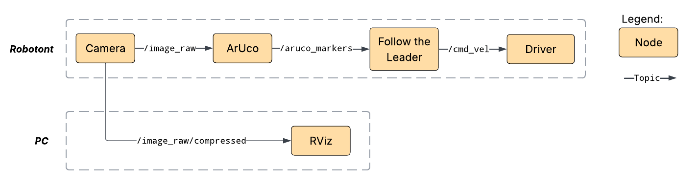

# demo_ar_follow_the_leader
This demo makes Robotont follow and keep a certain distance from **ArUco** markers.
The marker recongnition and control logic is done on the **robot**, while the camera feed is streamed to your **PC**.

## Prerequisites
### Installing dependencies on Robotont
Let `rosdep` install necessary packages:
```bash
# move to demo repository
cd ~/jazzy_demos

# install dependancies
rosdep install -from-paths src --ignore-src -r -y
```

## Launching the demo
First, build the project and source the workspace:
```bash
# move to demo repository
cd ~/jazzy_demos

# source ROS2
source /opt/ros/jazzy/setup.bash

# build the workspace 
colcon build

# source built packages
source install/setup.bash
```

The demo consists of two launch files:

* `robot.launch.py` runs on the robot and performs marker detection and following.
* `pc.launch.py` runs on the host computer and opens `rviz` to visualize the robot's camera feed.

The robot launch file declares the following parameters, which can be overridden from the command line:

| Parameter | Default | Description |
|---|---|---|
| `robot_id` | `0` | Identifier used to construct topic names. This node does not create new topics, only subscribes to existing ones |
| `marker_id` | `0` | ID of the ArUco marker to detect |
| `marker_size` | `0.0625` | Physical size of the marker in meters, used for distance estimation |

Start the demo on the **robot**:
```bash
# launch the demo on Robotont
ros2 launch demo_ar_follow_the_leader robot.launch.py robot_id:=<id> marker_id:=<id> marker_size:=<length>
```

Start the visualization on **PC**:
```bash
# launch the visualization on PC
ros2 launch demo_ar_follow_the_leader pc.launch.py
```
The visualization requires the robot and the computer to be on the same network. The camera feed topic is preconfigured in `rviz`, but update `rtXX` in the topic name to match your robot's identifier.

## Architecture
The diagram below shows a simplified view of how the nodes and topics are connected.


